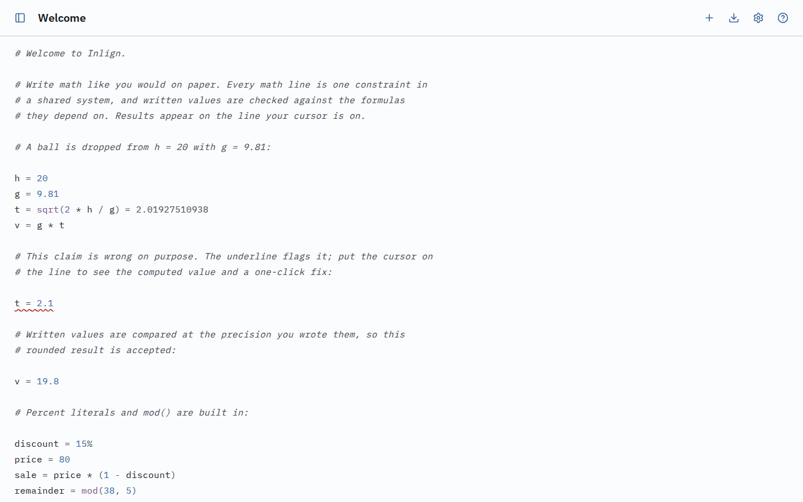
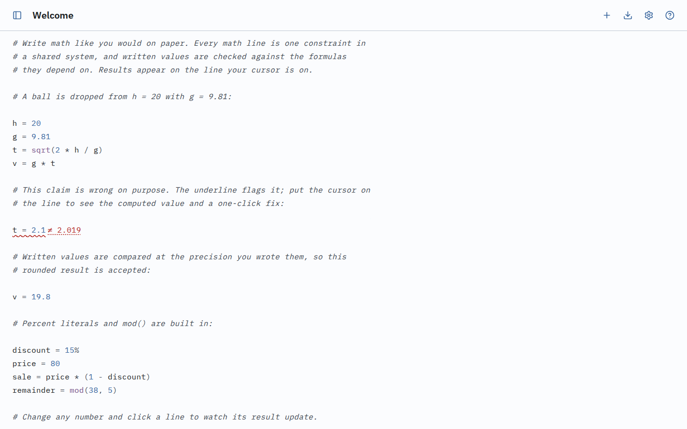
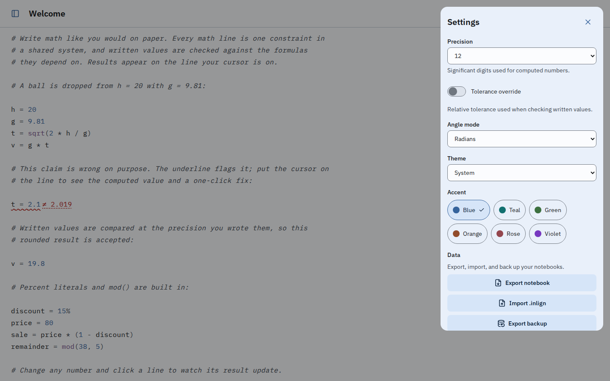
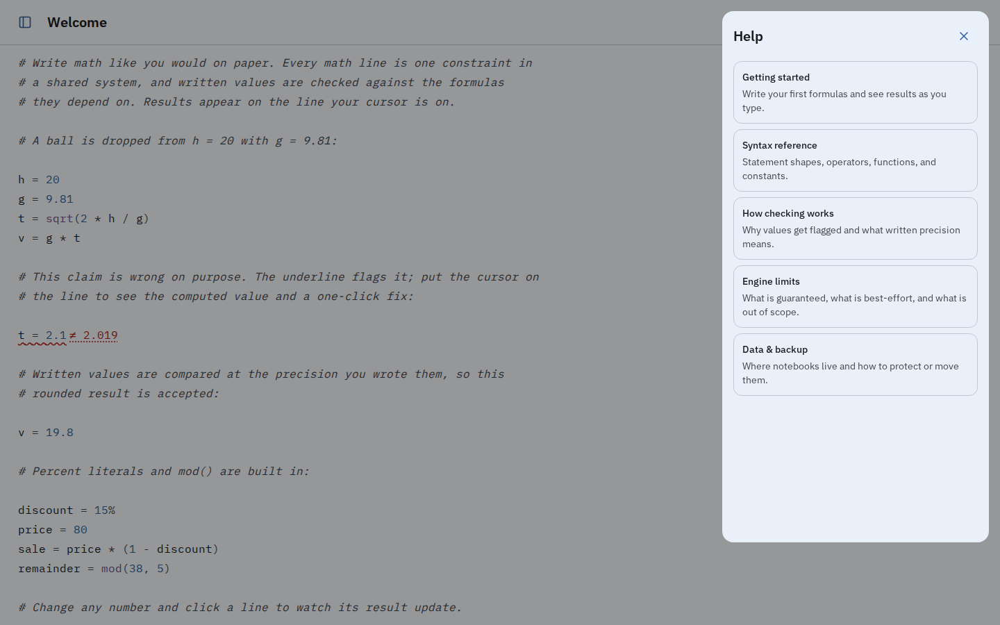
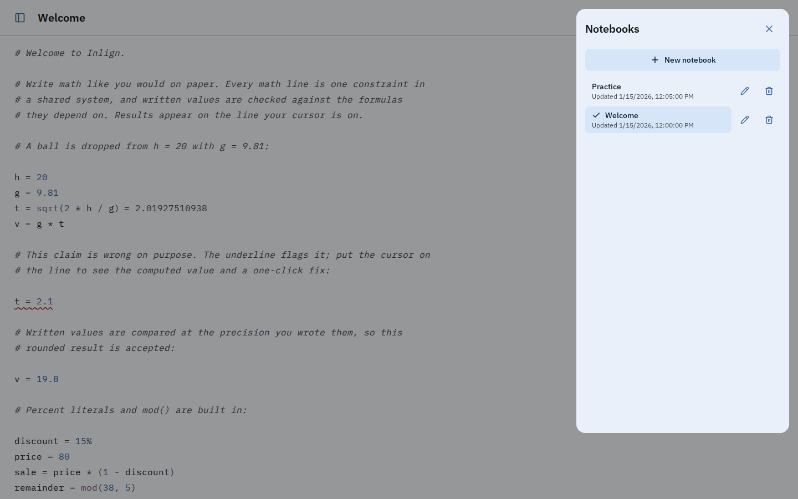

# Inlign

Inlign is a local-first live mathematical notepad: a plain-text document where
you draft a solution — prose, values, formulas, equations — and a general-purpose
math engine computes every value it can as you type, showing it at the end of
the line you are editing. It also
cross-checks the values you wrote against what the rest of the document implies,
quietly flags the ones that do not add up, and offers a one-click fix.

It ships as an installable offline PWA and as Windows, macOS, Linux and Android
wrappers built with Tauri v2 (iOS is covered by the PWA). Everything runs on the
device: no account, no server, no telemetry, zero network calls after load.

> **Status:** `v0.1.0` — all V1 features below are implemented. Tagged releases
> publish the native installers from CI; the PWA deploys from `main` and from
> version tags. macOS and Linux artifacts are unsigned.

## Why it exists

Calculators make you think in one expression at a time; spreadsheets make you
think in cells. Neither lets you draft the way you think: a page of notes with
values and formulas, revised as you go. Existing notepad calculators evaluate but
do not verify what you wrote; computer algebra systems solve but demand a special
workflow. Inlign combines both — a document that computes and checks itself.

```
The ball is dropped from a height of h = 20.
g = 9.81
Fall time: t = sqrt(2 * h / g)
t = 2.1          ← conflict: expected ≈ 2.019       [replace with computed]
Impact speed: v = g * t
v = 20.6
```

## What is in V1

| Area             | What it does                                                                                                                                                                                                                              |
| ---------------- | ----------------------------------------------------------------------------------------------------------------------------------------------------------------------------------------------------------------------------------------- |
| **Editor**       | CodeMirror 6 with math syntax highlighting, inline results, quiet inline errors and click-to-fix conflict markers                                                                                                                         |
| **Engine**       | The whole document is one order-independent constraint system: symbolic rearrangement plus numeric solving, written values checked at the precision they were written, never a guessed number (unsupported cases stay quietly unresolved) |
| **Notebooks**    | Multiple documents in IndexedDB, autosave, editable titles, last-modified switcher, `.inlign` text export/import, JSON backup/restore                                                                                                     |
| **Settings**     | Light/Dark/OLED themes with six accents, angle mode, precision and tolerance, backup and data controls                                                                                                                                    |
| **Help**         | Built-in documentation: getting started, syntax reference, how checking works, engine limits, data & backup                                                                                                                               |
| **Distribution** | Installable offline PWA; Tauri v2 desktop and Android builds; tag-driven releases publish the native artifacts                                                                                                                            |

## Screenshots

The editor with a computed result on the focused line and a conflicting claim,
plus the settings, help and notebook sheets.



| Conflict detail                                                                                           | Settings                                                                                                         |
| --------------------------------------------------------------------------------------------------------- | ---------------------------------------------------------------------------------------------------------------- |
|  |  |

| Help                                                                                      | Notebook switcher                                                                |
| ----------------------------------------------------------------------------------------- | -------------------------------------------------------------------------------- |
|  |  |

## Getting started

Requires Node 22.12 or newer and npm.

```bash
npm install
npm run dev        # Vite dev server on http://localhost:5173
npm run dev:lan    # dev server on http://0.0.0.0:7406 (strict; PORT overrides)
./scripts/live.sh  # the same server in the background (LIVE_SERVER_PORT overrides)
```

`npm run dev:lan` and `./scripts/live.sh` bind `0.0.0.0:7406` so the app can be
opened from a phone or another device on the same network. `live.sh` writes its
output to `/tmp/inlign-liveserver.log` and its pid to
`/tmp/inlign-liveserver.pid`; stop it with
`kill $(cat /tmp/inlign-liveserver.pid)`.

To test installability and offline mode, run `npm run build && npm run preview`.
The service worker is disabled in the dev server.

Other commands:

| Command                            | Purpose                                                             |
| ---------------------------------- | ------------------------------------------------------------------- |
| `npm run build`                    | Typecheck, production build and PWA service worker                  |
| `npm run preview`                  | Serve the production build                                          |
| `npm test`                         | Vitest run (jsdom, fake-indexeddb)                                  |
| `npm run test:e2e`                 | Playwright end-to-end suite                                         |
| `npm run typecheck`                | `tsc -b` across the app and node configs                            |
| `npm run lint`                     | ESLint (flat config)                                                |
| `npm run format`                   | Prettier write                                                      |
| `npm run format:check`             | Prettier check (CI gate)                                            |
| `npm run icons`                    | Regenerate PWA icons into `public/icons/`                           |
| `npm run icons:native`             | Regenerate Tauri and Android icons from `public/icons/icon-512.png` |
| `npm run accents`                  | Regenerate the accent palettes into `src/theme/accents.css`         |
| `npm run screenshots`              | Capture desktop screenshots into `screenshots/`                     |
| `npm run tauri:build`              | Desktop bundles (needs Rust and platform toolchains)                |
| `npm run android:init`             | Generate the Android project (first run only; needs the toolchain)  |
| `npm run android:apk`              | Android release APK (needs JDK 17, Android SDK/NDK and Rust)        |
| `npm run version:set -- <version>` | Bump `package.json`, `package-lock.json` and `src-tauri/Cargo.toml` |

## Install

The PWA deploys to GitHub Pages on `main` pushes and on version tags, and
installs from the browser — on iOS, use Safari's Add to Home Screen. Native
installers for Windows, macOS, Linux and Android are attached to GitHub releases
when a `v*` tag is pushed; macOS and Linux artifacts are unsigned in v1, so
Gatekeeper and some Linux desktops need a manual allow.

## Documentation

- [`masterplan.md`](masterplan.md) — the distilled product direction this README
  summarizes.
- [Design spec](docs/superpowers/specs/2026-10-07-inlign-design.md) — the
  approved V1 design, decision log and risks.
- [`AGENTS.md`](AGENTS.md) — architecture, conventions and the hard rules the
  code follows.

## Privacy

Inlign makes no network calls after the page loads. There is no account, no
sync, no analytics and no telemetry. Notebooks live in your browser's IndexedDB
and never leave the device unless you export them yourself.

## License

MIT — see `LICENSE`.
